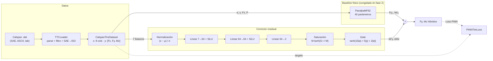
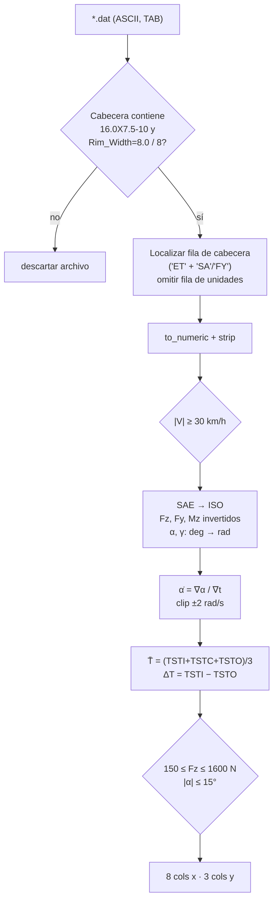
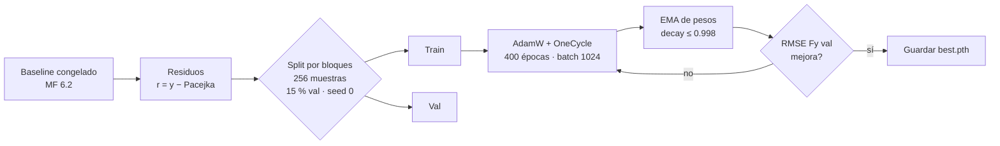

# TeR-Tire

**Modelo grey-box del neumático Hoosier 16.0×7.5-10 R20 (llanta 8 in)**: Magic Formula Pacejka 6.2 diferenciable en PyTorch + corrector residual PINN (7 → 64 → 64 → 2), entrenado sobre el dataset Calspan TTC Round 9. Desarrollado por Team Ter26 para simulación de dinámica vehicular de monoplaza Formula SAE.

> Idea central: la física aporta la estructura y la red aprende solo el **residuo** que la Magic Formula no captura. Con la red inicializada a cero, el modelo arranca exactamente en Pacejka y solo se aparta de él donde los datos lo justifican.

---

## Índice

1. [Resumen ejecutivo](#1-resumen-ejecutivo)
2. [Arquitectura](#2-arquitectura)
3. [Pipeline de datos](#3-pipeline-de-datos)
4. [Baseline físico: Pacejka MF 6.2](#4-baseline-físico-pacejka-mf-62)
5. [Corrector residual: ResidualTireMLP](#5-corrector-residual-residualtiremlp)
6. [Función de pérdida PINN](#6-función-de-pérdida-pinn)
7. [Entrenamiento](#7-entrenamiento)
8. [Diagnóstico y experimentos](#8-diagnóstico-y-experimentos)
9. [Exportación a C++ / Godot](#9-exportación-a-c--godot)
10. [Estructura del repositorio](#10-estructura-del-repositorio)
11. [Puesta en marcha](#11-puesta-en-marcha)
12. [Supuestos](#12-supuestos)
13. [Limitaciones y problemas conocidos](#13-limitaciones-y-problemas-conocidos)

---

## 1. Resumen ejecutivo

| Aspecto | Valor |
|---|---|
| Neumático | Hoosier 16.0×7.5-10 R20, llanta 8 in, bias-ply |
| Datos | Calspan TTC Round 9, runs **8 y 9** (cornering, SI ASCII), ≈107 k muestras tras filtrado (cifra del docstring de `01_fit_baseline_mf.py`) |
| Frecuencia de muestreo | 100 Hz (Δt = 0.01 s) |
| Baseline | Pacejka MF 6.2, **40 parámetros** (19 Fy0 + 21 Mz0), ajustados por Adam |
| Corrector | MLP residual 7 → 64 → 64 → 2, SiLU, **4 802 parámetros** entrenables |
| Salidas | ΔFy [N], ΔMz [N·m] con saturación suave |
| Régimen | **Deslizamiento lateral puro** (sin κ, sin Fx, sin relajación) |
| Pérdida | Huber sobre residuos + penalización de pasividad + L2 |
| Exportación | Header C++17 *header-only* con pesos y coeficientes MF 6.2 |

---

## 2. Arquitectura



**Principio de diseño.** El baseline es *diferenciable de extremo a extremo* y el residual se suma aditivamente:

$$
F_y(\cdot) = \underbrace{F_{y,0}^{\text{MF62}}(\alpha,\gamma,F_z,P)}_{\text{física}} + \underbrace{\Delta F_y(\alpha,\dot\alpha,\gamma,F_z,P,\bar T,\Delta T)}_{\text{red, gated}}
$$

Análogo para $M_z$. Con $\Delta = 0$ (inicialización de la última capa a cero) el modelo es exactamente MF 6.2.

---

## 3. Pipeline de datos



### 3.1 Convención de signos (SAE → ISO)

| Canal SAE | Unidad | Transformación ISO | Motivo |
|---|---|---|---|
| `FZ` | N (negativo) | $F_z = -F_{Z,\text{SAE}}$ | Fz positiva hacia arriba |
| `FY` | N | $F_y = -F_{Y,\text{SAE}}$ | Convención de ejes ISO |
| `MZ` | N·m | $M_z = -M_{Z,\text{SAE}}$ | Coherente con $F_y$ |
| `SA` | deg | $\alpha = \text{rad}(SA)$ | Sin inversión |
| `IA` | deg | $\gamma = \text{rad}(IA)$ | Caída en radianes |

Con esta convención, para $\gamma \approx 0$ y $|\alpha| > 0.02$ rad, los datos deben cumplir $F_y \cdot \mathrm{sign}(\alpha) > 0$. Lo verifica `02_train_pinn.py` al arrancar (porcentaje de violaciones en datos medidos, debe ser ≈ 0).

### 3.2 Filtros aplicados

| Filtro | Umbral | Razón |
|---|---|---|
| Cabecera del archivo | `16.0X7.5-10`, `Rim_Width=8.0` | Solo el neumático y llanta objetivo |
| Velocidad | $\lvert V\rvert \ge 30$ km/h | Dinámica de arranque del rodillo |
| Carga vertical | $150 \le F_z \le 1600$ N | Fuera de rango, la curva no es representativa |
| Ángulo de deriva | $\lvert\alpha\rvert \le 15°$ | Región lineal-saturada; excluye transitorios extremos |

### 3.3 Features

| Índice | Símbolo | Canal fuente | Uso |
|---|---|---|---|
| 0 | $\alpha$ | `SA` | Entrada red + baseline |
| 1 | $\dot\alpha$ | derivada de `SA` | Entrada red (memoria/transitorio) |
| 2 | $\gamma$ | `IA` | Entrada red + baseline |
| 3 | $F_z$ | `FZ` | Entrada red + baseline |
| 4 | $P$ | `P` (kPa) | Entrada red + baseline |
| 5 | $\bar T$ | media `TSTI/TSTC/TSTO` | Entrada red |
| 6 | $\Delta T$ | `TSTI − TSTO` | Gradiente térmico lateral (entrada red) |
| 7 | $\kappa$ | `SL`/`SR` | **Cargada pero descartada** por `x[:, :7]` |

---

## 4. Baseline físico: Pacejka MF 6.2

Implementado en `physics/pacejka_baseline.py` como `nn.Module` con todos los coeficientes como `nn.Parameter`, por lo que el gradiente fluye hasta cada $p_{\bullet}$ y $q_{\bullet}$.

**Variables normalizadas**

$$
d_{Fz} = \frac{F_z - F_{z0}}{F_{z0}}, \qquad d_{P} = \frac{P - P_0}{P_0}, \qquad F_{z0}=700\,\text{N},\; P_0=82.7\,\text{kPa},\; r_0=0.2032\,\text{m}
$$

### 4.1 Fuerza lateral $F_{y0}$

$$
\begin{aligned}
\mu_y &= (D_{y1} + D_{y2}\,d_{Fz})(1 + p_{py1}\,d_P)(1 - D_{y3}\gamma^2) \\
D_y &= \mu_y\,F_z \\
K_{y\alpha 0} &= K_{y1}\,F_{z0}\,\sin\!\Big(2\arctan\tfrac{F_z}{K_{y2}F_{z0}}\Big)(1 + p_{py2}\,d_P) \\
B_y &= \dfrac{K_{y\alpha 0}}{C_y D_y}, \qquad S_{Hy} = H_{y1} + H_{y2}\,d_{Fz} + H_{y3}\gamma \\
S_{Vy} &= F_z\big[(V_{y1}+V_{y2}\,d_{Fz}) + (V_{y3}+V_{y4}\,d_{Fz})\gamma\big] \\
E_y &= \tanh(E_{y1}+E_{y2}\,d_{Fz})\big(1 - (E_{y3}+E_{y4}\gamma)\,\mathrm{sign}(\alpha_y)\big), \qquad \alpha_y = \alpha + S_{Hy} \\
F_{y0} &= D_y\,\sin\!\Big\{C_y\arctan\big[B_y\alpha_y - E_y(B_y\alpha_y - \arctan B_y\alpha_y)\big]\Big\} + S_{Vy}
\end{aligned}
$$

### 4.2 Momento autoalineante $M_{z0}$

$$
\begin{aligned}
\alpha_t &= \alpha + q_{Hz1} + q_{Hz2}\,d_{Fz} + (q_{Hz3} + q_{Hz4}\,d_{Fz})\gamma \\
D_t &= F_z\,\tfrac{r_0}{F_{z0}}(q_{Dz1}+q_{Dz2}\,d_{Fz})(1+q_{pz1}\,d_P)(1 - q_{Dz3}|\gamma|) \\
B_t &= \dfrac{(q_{Bz1}+q_{Bz2}d_{Fz}+q_{Bz3}d_{Fz}^2)(1+q_{Bz5}|\gamma|)\,r_0}{F_{z0}D_t} \\
E_t &= \tanh(q_{Ez1}+q_{Ez2}\,d_{Fz})\big(1+(q_{Ez4}+q_{Ez5}\gamma)\mathrm{sign}(\alpha_t)\big) \\
t &= D_t\cos\!\Big\{q_{Cz1}\arctan\big[B_t\alpha_t - E_t(B_t\alpha_t - \arctan B_t\alpha_t)\big]\Big\}\cos\alpha \\
M_{zr} &= D_r\cos(\arctan B_r\alpha_r), \quad D_r = F_z r_0\big[(q_{Dz6}+q_{Dz7}d_{Fz}) + (q_{Dz8}+q_{Dz9}d_{Fz})\gamma\big] \\
\alpha_r &= \alpha + S_{Hy} + \dfrac{S_{Vy}}{K_{y\alpha0}}, \qquad B_r = \dfrac{r_0}{F_{z0}} \\
M_{z0} &= -\,t\,(F_{y0} - S_{Vy}) + M_{zr}
\end{aligned}
$$

> **Nota de implementación.** $B_r$ se fija a $r_0/F_{z0}$; el código tiene una rama `hasattr(self, 'q_Bz9')` que nunca se activa porque $q_{Bz9}$ no existe. Es código muerto, no un parámetro entrenable.

### 4.3 Parámetros ajustados

| Grupo | Nº | Entradas | Rango de uso |
|---|---|---|---|
| `p_Cy1, p_Dy1–3, p_Ey1–4, p_Ky1–2, p_Hy1–3, p_Vy1–4, p_py1–2` | 19 | Fy₀ | Forma lateral y dependencia con Fz, γ, P |
| `q_Bz1–3, q_Bz5, q_Cz1, q_Dz1–3, q_Dz6–9, q_Ez1–2, q_Ez4–5, q_Hz1–4, q_pz1` | 21 | Mz₀ | Autoalineación y trail |

Los valores finales viven en `config/pacejka_mf62_params.yaml` (generado por `01_fit_baseline_mf.py`).

---

## 5. Corrector residual: `ResidualTireMLP`

Implementado en `models/network.py`.

### 5.1 Flujo interno

```
 x ∈ ℝ⁷  ──► (x − μ)/σ  ──► Linear(7,64) ─ SiLU ─ Linear(64,64) ─ SiLU ─ Linear(64,2)
                                                                             │
        ┌────────────────────────────────────────────────────────────────────┘
        ▼
 ΔFy = 600 · tanh( r₁ · 250 / 600 ) · g        ΔMz = 30 · tanh( r₂ · 10 / 30 ) · g
                                  g = tanh(15|α| + 5|γ| + 2|α̇|)
```

| Elemento | Valor | Propósito |
|---|---|---|
| Normalización | $\mu=[0,0,0,800,83,62,1.5]$, $\sigma=[0.15,0.25,0.06,450,20,14,8]$ | Entradas O(1) para SiLU |
| Escala de salida | $S_{Fy}=250$ N, $S_{Mz}=10$ N·m | Pendiente lineal cerca de 0 |
| Saturación | $M_{Fy}=600$ N, $M_{Mz}=30$ N·m | Guarda de extrapolación (no es límite de ajuste) |
| Inicialización | última capa a cero | Arranque exacto en Pacejka |
| Parámetros | **4 802** | 512 + 4 160 + 130 |

### 5.2 Gate: por qué el residual se apaga en el origen

$$
g(\alpha,\gamma,\dot\alpha) = g_{\text{floor}} + (1-g_{\text{floor}})\tanh\!\big(15|\alpha| + 5|\gamma| + 2|\dot\alpha|\big), \qquad g_{\text{floor}}=0
$$

| $\lvert\alpha\rvert$ | $g$ (aprox.) | Lectura |
|---|---|---|
| 0.00 rad (0°) | 0.00 | Residual silenciado |
| 0.02 rad (≈1.1°) | 0.29 | Transición |
| 0.10 rad (≈5.7°) | 0.90 | Residual activo |

**Trade-off explícito.** El gate impide que la red corrija la rigidez lineal cerca de cero deriva. Es una decisión deliberada para no contaminar el origen con ruido de sensor, pero implica que la pendiente $C_\alpha$ queda enteramente en manos de Pacejka. `03_diagnose.py` mide el sesgo en $|\alpha| < 0.01$ rad precisamente para decidir si hay que subir `gate_floor`.

---

## 6. Función de pérdida PINN

Implementada en `models/physics_loss.py` como `PINNTireLoss`.

$$
\mathcal{L} = \lambda_d\,\mathcal{L}_{\text{data}} + \lambda_p\,\mathcal{L}_{\text{pas}} + \lambda_r\,\mathcal{L}_{\text{reg}}, \qquad \lambda_d=1,\;\lambda_p=0.5,\;\lambda_r=10^{-4}
$$

| Término | Definición | Escala de normalización |
|---|---|---|
| $\mathcal{L}_{\text{data}}$ | $\mathrm{Huber}_{\delta=5}\!\big(\tfrac{\Delta F_y}{70},\tfrac{r_{Fy}}{70}\big) + \mathrm{Huber}_{\delta=5}\!\big(\tfrac{\Delta M_z}{8.3},\tfrac{r_{Mz}}{8.3}\big)$ | RMSE de Pacejka → ambos canales pesan igual |
| $\mathcal{L}_{\text{pas}}$ | $\mathbb{E}\big[\mathrm{ReLU}(-\tfrac{F_y}{2500}\mathrm{sign}\alpha)^2\big]$ en máscara $\lvert\gamma\rvert<0.015 \wedge \lvert\alpha\rvert>0.02$ | Penaliza potencia disipada negativa |
| $\mathcal{L}_{\text{reg}}$ | $\mathbb{E}\big[(\tfrac{\Delta F_y}{2500})^2\big] + \mathbb{E}\big[(\tfrac{\Delta M_z}{40})^2\big]$ | Empuja $\Delta\to 0$ en zonas ambiguas |

> **Nota.** Con $\delta=5$ sobre valores escalados por 70 N, la zona cuadrática de Huber llega a ±350 N: en la práctica es MSE. El nombre "Huber" es más conservador de lo que el comportamiento real sugiere.

La restricción de pasividad es **blanda** (penalización), no una garantía. Ver §13.

---

## 7. Entrenamiento

### 7.1 Fase 0: ajuste del baseline — `training/01_fit_baseline_mf.py`

Ajuste desacoplado en dos fases, full-batch sobre todo el dataset:

| Fase | Parámetros | Optimizador | LR | Épocas | Pérdida |
|---|---|---|---|---|---|
| 1 | `p_*` (Fy₀) | Adam | 0.02 | 1 500 | MSE sobre Fy |
| 2 | `q_*` (Mz₀), Fy congelado | Adam | 0.01 | 1 500 | MSE sobre Mz |

Exporta `config/pacejka_mf62_params.yaml`. **Sin cotas** sobre los parámetros: pueden salir de rango físico.

### 7.2 Fase 1: corrector PINN — `training/02_train_pinn.py`



| Hiperparámetro | Valor |
|---|---|
| Épocas | 400 |
| Batch | 1 024 |
| Optimizador | AdamW, $\eta_{\max}=3\cdot10^{-3}$, weight decay $10^{-4}$ |
| Schedule | OneCycle, cos, `pct_start=0.1`, `final_div_factor=100` |
| Clipping | norma de gradiente ≤ 1.0 |
| EMA | $d_t = \min(0.998, (1+t)/(10+t))$ |
| Validación | 15 % de bloques contiguos de 256 muestras (≈2.56 s a 100 Hz) |
| Selección | Mejor época por RMSE Fy en validación (sobre pesos EMA) |

**Por qué bloques contiguos.** Muestras vecinas en una serie a 100 Hz están casi duplicadas; un split aleatorio por muestra produciría una validación optimista por fuga temporal. El script además imprime la mediana de $|\Delta\alpha|$ entre muestras consecutivas como comprobación de orden temporal.

### 7.3 Diagnósticos de arranque

`02_train_pinn.py` imprime antes de entrenar:

- RMSE de Pacejka global (línea base a batir)
- Fracción de $|r_{Fy}|$ por encima de la guarda de 600 N y del antiguo límite de 250 N
- Sesgo de $r_{Fy}$ en $|\alpha|<0.01$ rad
- Violación de signo $F_y\mathrm{sign}(\alpha)$ en datos **medidos**

---

## 8. Diagnóstico y experimentos

### 8.1 `training/03_diagnose.py`: suelo de ruido y error por condición

- **Ruido**: $\sigma$ estimado con la segunda diferencia $d_2 = y_{t-1} - 2y_t + y_{t+1}$, robusto por MAD. Para ruido blanco $\mathrm{Var}(d_2) = 6\sigma^2$, así que $\hat\sigma = 1.4826\,\text{MAD}(d_2)/\sqrt{6}$.
- **Autocorrelación lag-1** del error híbrido: ≈1 indica error sistemático lento; ≈0 indica ruido blanco. Es el criterio para decidir si queda margen de mejora o ya se alcanzó el suelo de ruido.
- **Desglose en VAL** por $|\alpha|$, $F_z$, $\gamma$, $P$, $\bar T$ y $\dot\alpha$: RMSE de Pacejka vs híbrido y sesgo por bin.

### 8.2 `training/04_experiments.py`: causa raíz

Pregunta que responde: *¿la red memoriza por reloj térmico o por condiciones reales?* Por eso prueba ablaciones de las entradas térmicas y de presión.

| Configuración | Entradas eliminadas | Otros cambios |
|---|---|---|
| `full` | — | Base |
| `sin_termico` | $\bar T$, $\Delta T$ | — |
| `sin_termico+P` | $P$, $\bar T$, $\Delta T$ | — |
| `sin_alpha_dot` | $\dot\alpha$ | — |
| `full_ruido0.05` | — | Ruido gaussiano 5 % sobre entradas |
| `full_wd1e-2` | — | Weight decay $10^{-2}$ |
| `sinterm_h128_reg` | $\bar T$, $\Delta T$ | Ancho 128, wd $10^{-3}$, ruido 2 % |

Protocolos: **bloques** (como 02), **8→9** y **9→8** (entrenar en un run, validar en el otro). Los dos últimos son la prueba de generalización real entre sesiones. Entrenamiento de 150 épocas, semilla 0.

---

## 9. Exportación a C++ / Godot

`export/export_c_header.py` genera un header C++17 *header-only* en el namespace `Mirena::Physics::Tire`:

| Símbolo | Contenido |
|---|---|
| `X_MEAN[7]`, `X_STD[7]` | Normalización de entrada |
| `OUT_SCALE_FY/MZ`, `MAX_DELTA_FY/MZ` | Escalas y saturaciones |
| `W0[64][7]`, `B0[64]` | Capa 0 |
| `W2[64][64]`, `B2[64]` | Capa 2 |
| `W4[2][64]`, `B4[2]` | Capa 4 |
| `PacejkaMF62Coeffs MF62_PARAMS` | fz0, p0, r0 y los 40 coeficientes |

Los arrays de pesos y sesgos van alineados a 32 bytes (`alignas(32)`) para vectorización AVX; los de normalización no.

> **Lo que el header *no* contiene.** Solo pesos y coeficientes. La forward pass (MF 6.2, MLP, gate, saturación) debe reimplementarse en el consumidor. El directorio de destino `godot_integration/cpp_extension/` no existe en el repo, y `export_onnx.py` y `PinnTire.gd` están vacíos.

---

## 10. Estructura del repositorio

```
TeR-Tire/
├── config/
│   ├── pacejka_mf62_params.yaml   ✅ 40 coeficientes (salida de 01)
│   ├── ttc_dataset.yaml           ✅ canales, conversiones SAE→ISO, filtros
│   ├── tire_specs.yaml            ✅ geometría, presión nominal, rigideces
│   └── pinn_config.yaml           ⬜ vacío
├── data/
│   ├── loaders.py                 ✅ parser .dat + Dataset PyTorch
│   └── raw_ttc/                   📦 runs 2356-run2…run79 (Round 9)
├── physics/
│   ├── pacejka_baseline.py        ✅ MF 6.2 diferenciable
│   ├── friction_envelope.py       ⬜ vacío
│   ├── relaxation.py              ⬜ vacío
│   └── thermal_core.py            ⬜ vacío
├── models/
│   ├── network.py                 ✅ ResidualTireMLP
│   ├── grey_box_tire.py           ✅ baseline + residual
│   └── physics_loss.py            ✅ PINNTireLoss
├── training/
│   ├── 01_fit_baseline_mf.py      ✅ ajuste MF 6.2
│   ├── 02_train_pinn.py           ✅ entrenamiento PINN
│   ├── 03_diagnose.py             ✅ ruido + error por condición
│   ├── 04_experiments.py          ✅ ablaciones y folds cruzados
│   ├── visual_train_pinn.py       🟡 entrenamiento animado (matplotlib)
│   └── checkpoint_manager.py      ⬜ vacío
├── validation/
│   ├── benchmark_rmse.py          ⬜ vacío
│   ├── plot_carpet_sweeps.py      ⬜ vacío
│   └── test_passivity.py          ⬜ vacío
├── vehicle_kernel/
│   ├── quarter_car_sim.py         ⬜ vacío
│   └── single_wheel_transient.py  ⬜ vacío
├── export/
│   ├── export_c_header.py         ✅ pesos → C++ header
│   ├── export_onnx.py             ⬜ vacío
│   └── weights/
│       ├── pinn_residual_best.pth ✅ (≈23 KB)
│       └── pinn_residual_viz.pth  🟡 sin script productor en el repo
└── godot_integration/gdscript_stub/
    └── PinnTire.gd                ⬜ vacío
```

| Leyenda | Significado |
|---|---|
| ✅ | Implementado y en uso |
| 🟡 | Implementado con problemas conocidos (§13) |
| ⬜ | Archivo presente, sin contenido: placeholder |

---

## 11. Puesta en marcha

**Requisitos.** Python 3.12, PyTorch, NumPy, pandas, PyYAML y matplotlib (solo para la visualización). CUDA es opcional; todos los scripts caen a CPU. No hay `requirements.txt`.

**Ejecutar siempre desde la raíz del repo.** Las rutas de configuración y datos son relativas al directorio de trabajo.

```bash
# 1. Ajustar la Magic Formula (sobrescribe config/pacejka_mf62_params.yaml)
python training/01_fit_baseline_mf.py

# 2. Entrenar el residual PINN (guarda export/weights/pinn_residual_best.pth)
python training/02_train_pinn.py

# 3. Diagnóstico de ruido y error por condición
python training/03_diagnose.py

# 4. Ablaciones y validación cruzada entre runs (≈ tiempo considerable)
python training/04_experiments.py

# 5. Exportar a header C++
python export/export_c_header.py
```

> **Orden obligatorio.** `02` depende de `01`, y `03`/`04`/`export` dependen de `02`.
>
> **Cuidado con `visual_train_pinn.py`.** Sobrescribe `pinn_residual_best.pth` con pesos **no-EMA** de otra ejecución (180 épocas). Ver §13.

---

## 12. Supuestos

Explícitos, para que cualquier cambio de premisa invalide lo correcto:

1. **Convención ISO tras inversión SAE.** Fz, Fy y Mz se invierten; α y γ se convierten de grados a radianes sin cambio de signo.
2. **Régimen de deslizamiento puro lateral.** Fx y κ no participan en el modelo.
3. **Tasa de muestreo de 100 Hz** (Δt = 0.01 s, verificado en `run8`). El fallback de `dt` a 0.01 s en el loader depende de esto.
4. **Presión nominal 82.7 kPa (12 psi)** y **Fz₀ = 700 N** como puntos de referencia del MF 6.2.
5. **Radio no cargado** $r_0 = 0.2032$ m (16 in de diámetro).
6. **Temperatura de banda** se toma como media de TSTI/TSTC/TSTO; el gradiente lateral $\Delta T$ es TSTI − TSTO.
7. **Estacionariedad entre runs 8 y 9.** Se asume que la dinámica del neumático es comparable entre sesiones; la validación 8→9 / 9→8 es la prueba de esta hipótesis.
8. **Neumático único, compuesto único, presión única.** Ningún resultado se extrapola a otros neumáticos o compuestos.

---

## 13. Limitaciones y problemas conocidos

### 13.1 Alcance del modelo

| Limitación | Impacto |
|---|---|
| Solo deslizamiento lateral puro | No sirve para frenada o tracción combinada |
| Sin relajación transitoria | `relaxation.py` vacío; $\dot\alpha$ es solo feature de la red |
| Sin modelo térmico | `thermal_core.py` vacío; $\bar T$ y $\Delta T$ entran como features sin dinámica propia |
| Un neumático, un compuesto, un rango de presión | Generalización no demostrada |
| $\lvert\alpha\rvert \le 15°$ y $150 \le F_z \le 1600$ N | Fuera de esos rangos el comportamiento es no controlado |

### 13.2 Datos

| Problema | Detalle | Estado |
|---|---|---|
| Canal `SR` ≈ −1.0 constante | En cornering no es un slip ratio válido | `kappa` no se usa, pero no es fiable |
| Canal `RE` con picos espurios | Valores de ±3·10⁵ cm | No se usa |
| $\dot\alpha$ calculada **después** del filtro de velocidad | Los huecos crean derivadas falsas en los bordes; luego se recorta a ±2 rad/s | Afecta a la feature 1, sin corrección |
| `kappa` cargado y descartado | `x[:, :7]` lo elimina en silencio | Funcional, pero confuso |
| Bloques de validación que cruzan frontera de run | Concatenación 8+9 antes del split | Fuga menor en las fronteras |

### 13.3 Método

| Problema | Consecuencia |
|---|---|
| Semilla única (0) para split, init y ejecuciones | Sin intervalos de confianza sobre las métricas |
| Pasividad como penalización blanda | No garantiza $F_y \mathrm{sign}\alpha \ge 0$ fuera de la máscara |
| `validation/test_passivity.py` vacío | La propiedad no se verifica de forma automática |
| Baseline sin cotas | Los parámetros MF pueden salir de rango físico sin aviso |

### 13.4 Código

| Problema | Ubicación | Corrección sugerida |
|---|---|---|
| **Checkpoint sobrescrito con pesos distintos** | `visual_train_pinn.py` guarda sin EMA en `pinn_residual_best.pth`, con 180 épocas en vez de 400 | Parametrizar la ruta o reutilizar `02_train_pinn.py` |
| Código muerto en $M_{zr}$ | `hasattr(self, 'q_Bz9')` nunca es cierto | Eliminar la rama o añadir $q_{Bz9}$ como parámetro |
| Comentario desalineado | `01_fit_baseline_mf.py` documenta `[alpha, kappa, gamma, …]`; el orden real es `[alpha, alpha_dot, gamma, …]` | Corregir el comentario |
| Duplicación de bucle de entrenamiento | `02`, `04` y `visual_train_pinn.py` repiten la lógica | Extraer a un módulo común |
| Rutas hardcodeadas | Datos y pesos en cada script | Centralizar en `config/` |
| Sin `requirements.txt` ni `.gitignore` | Los `__pycache__` `.pyc` aparecen versionados | Añadir ambos |
| Consumidor C++ ausente | El header no incluye la forward pass | Implementar `inference.hpp` con gate y saturación |

---

